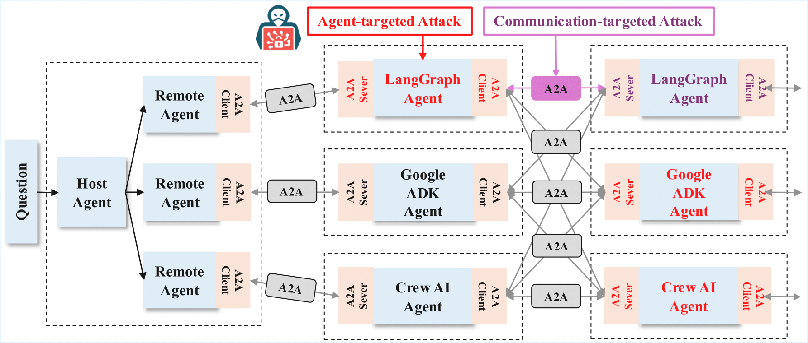
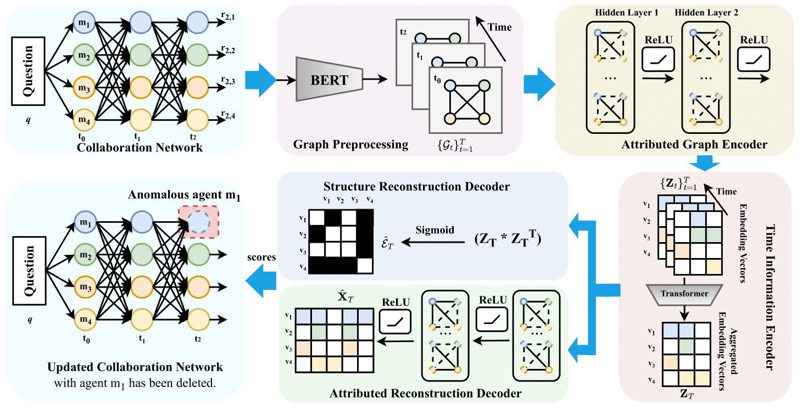

# GUARDIAN extension

An extension of **GUARDIAN: Safeguarding LLM Multi-Agent Collaborations with Temporal Graph Modeling** by Jialong Zhou, Lichao Wang and Xiao Yang ([paper](https://arxiv.org/abs/2505.19234)). The original code and method are theirs; this repo builds on top of it. Citation is at the bottom.

The goal is to scale GUARDIAN to around 10 agents and test different communication schemas (who talks to whom), focusing on agent-targeted and communication-targeted attacks. Results will come later.

## Quick recap of GUARDIAN

Several LLM agents debate a question over 3 rounds. Each round is turned into a graph (agents = nodes, answers = node features), and an unsupervised graph autoencoder flags the most anomalous agent, which is removed from later rounds. GUARDIAN uses a temporal model across rounds. GUARDIAN.s is the static variant that only looks at the current round.




## Layout

The original repo had three near-identical copies of the code, one per experiment. Everything is now combined in `code/guardian/`:

- `run.py`: single entry point, replaces the 12 test scripts and 3 run scripts
- `tasks.py`: MATH, MMLU, FEVER and biography (loading, prompts, scoring, wrong answers for attacks)
- `attacks.py`: `none` (hallucination amplification), `agent` and `communication`
- `LLMLP.py`: the debate loop and agent removal
- `LLM_Neuron.py`: a single agent
- `model_static.py`, `model_temporal_gib.py`: detectors (unchanged)
- `utils.py`, `prompt_lib.py`: answer parsing and comparison, prompts

The old per-experiment folders (`hallucination_amplification/`, `agent-targeted_.../`, `communication-targeted_.../`) have been removed. They're available in the [original repo](https://github.com/JialongZhou666/GUARDIAN).

## Running

```bash
pip install -r code/requirements.txt
pip install "math-verify[antlr4_13_2]"   # optional, symbolic answer comparison for MATH
export OPENAI_API_KEY=sk-...              # PowerShell: $env:OPENAI_API_KEY = "sk-..."
                                          # optional: OPENAI_API_BASE for another endpoint
cd code/guardian
python run.py --task math --attack none                        # hallucination amplification
python run.py --task math --attack agent                       # agent-targeted
python run.py --task math --attack communication               # communication-targeted
python run.py --task mmlu --attack agent --detector static     # GUARDIAN.s
python run.py --task math --n-samples 2                        # quick test
python run.py --task math --attack agent --attack-agents 0,2 --prune threshold            # 2 attackers, dynamic pruning
python run.py --task math --attack agent --agents 6 --attack-agents random:2 --prune threshold --prune-k 0.5
```

Output goes to `res.txt` (change it with `--output`). It's written as it goes, and each run overwrites the file. Other flags:

- `--model` (default `gpt-4o-mini`)
- `--math-levels` (default `all`)
- `--agents` (number of agents, default 4)
- `--attack-agents`: which agents are adversarial, default `0`. Use a list like `0,2`, or `random:K` for K random positions drawn per question. The draw is seeded by the question index, so each question gets the same attackers in every run with the same `--agents` and K, and runs stay paired question by question.
- `--prune`: `top1` (default, as in the paper) or `threshold`, see below
- `--prune-k`: k for threshold pruning (default 1.0)
- `--min-agents`: pruning never goes below this many agents (default 2)
- `--comm-schedule` (which agents get fake messages in which round, default `0:0;1:0,1`)
- `--data-path` for FEVER (`shared_task_dev.jsonl`) and biography (`article.json`); these files aren't in the repo
- `--judge-model` for biography fact-checking

Needs a CUDA GPU. `bert-base-uncased` is downloaded on first run.

## Changes from the original

**Setup and data**
- The original MATH dataset on Hugging Face (`lighteval/MATH`) isn't available anymore. Switched to `EleutherAI/hendrycks_math`, which has the same 5,000 test problems split by subject, so the subjects are combined first. The question order is probably different, so the 100 sampled questions don't match the paper's even with the same seed (42).
- `gpt-3.5-turbo` isn't available, so `gpt-4o-mini` is used for agents and the biography judge.
- Updated to the current `openai` package (the code used the pre-1.0 API). The API key comes from environment variables instead of being hard-coded.

**Math answer comparison**
- Numbers and fractions were extracted from the answer (dropping "The answer is"), but extraction happened twice: once when parsing an agent's reply, and again inside the comparison. The second pass could mangle already-clean answers, e.g. `\frac{42}{5}` became `5`.
- When there's no "The answer is", the fallback grabs the last number in the text.
- The comparison never parsed LaTeX fractions, so `\frac{42}{5}` and `8.4` didn't match.
- Now answers are extracted once, and `answers_equiv` compares the extracted answers: exact match, then numeric (including `a/b` and `\frac{a}{b}`), then symbolic via `math-verify` if installed.
- Early stopping (agreement check) and final answer selection (majority vote) used the same comparison logic as grading, so these fixes change debate behavior too, not just scoring.

**Bugs fixed in the original code**
- Hallucination experiment: in round 1, agents were counted but never actually called. Every question returned an empty answer after 3 "API calls".
- Agent attack: the attacker only got its wrong answer in round 1. The check for rounds 2 and 3 never matched, and agents have no memory between rounds.
- Communication attack: effectively never ran.
  - It was off by default.
  - It threw away the attacked agent's reply.
  - The fake messages came out as "role"/"content".
  - The round-2 attack never fired.
  - The static version would have crashed.
  - The fake agents always claimed the answer was "1.0".

  Now it attacks agent 0 in round 1 and agents 0 and 1 in round 2, and the fake agents argue for a different wrong answer per question.
- MMLU, FEVER and biography ran with math settings unless you edited the code by hand. The attacker always got the math prompt.
- Errors were silently skipped. They're now printed in the output.

**Dynamic threshold pruning**
- The original removed exactly one agent per round (the highest anomaly score), even when nothing was wrong. That can't handle several attackers, and it always removes an honest agent in clean runs.
- `--prune threshold` removes every agent whose score is above mean + k × std of that round's scores. That can be zero, one or several agents.
- `--prune-k` sets k. Lower is more aggressive. With few agents, k has to be fairly low: with 4 agents, a single outlier can only be about 1.7 std above the mean.
- `--min-agents` stops pruning from emptying the debate.
- The round loop now tracks agents by ID. The original used index math that only worked with one removal per round.
- The detector no longer runs after the final round. Its pick never changed the final answer.

**Multiple attack agents**
- `--attack-agents 0,2` or `--attack-agents random:K` makes several agents adversarial.
- Each question's output lists the attack agents and which agents were pruned in which round (with scores), so you can check whether the detector caught them.

**Other additions**
- Timestamps for run start/end, each question and each round.
- Anomaly scores for every agent each round, plus the threshold and who was pruned.
- The correct answer and score are printed after each question.

## Problems with GUARDIAN (observations so far)

- **It assumes the majority of agents are correct.** A correct minority gets pruned or ignored through early stopping.
- **Many problems reach early stopping before GUARDIAN does anything.** Agreement in round 1 ends the debate before the detector runs.
- **Agents tend to be either mostly wrong or mostly right.** This could be because every agent uses the same LLM.
- **Using different models per agent has its own problem.** The detector compares text embeddings of the agents' reasoning, so different writing styles could affect results regardless of correctness.


## Citation

Original paper:

```bibtex
@article{zhou2025guardian,
  title={GUARDIAN: Safeguarding LLM Multi-Agent Collaborations with Temporal Graph Modeling},
  author={Zhou, Jialong and Wang, Lichao and Yang, Xiao},
  journal={arXiv preprint arXiv:2505.19234},
  year={2025}
}
```
